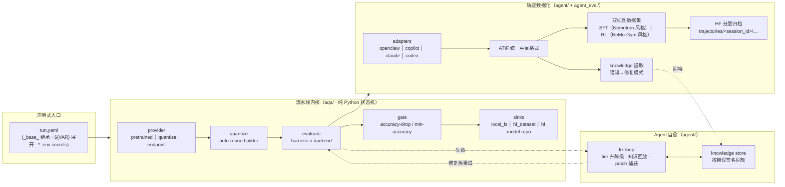

# autoquant-agent

Agent-driven **automatic model quantization + evaluation + self-healing**.

A declarative, extensible framework that turns a single `run.yaml` into a
`quantize → evaluate → gate` pipeline, with an agent fix/patch loop that
root-causes and repairs environment/code failures and captures reviewable
patches.

## Design

Four ideas shape the architecture:

1. **Eval-centric.** Evaluation is the core job; *how the model is produced or
   served* (a HF repo, a quantized checkpoint, a live endpoint) is a swappable
   **`provider`**. Quantization is just one provider, not the center of gravity.
2. **Declarative + reproducible.** One typed `run.yaml` is the single parse point
   (`config.py`). Per-benchmark knobs live in pinned recipe files
   (`recipes/benchmarks/*.yaml`), so a task's correct settings travel with the
   task, not with every run. Secrets are referenced only via `*_env` variables.
3. **Plugin registries, no forks.** Providers, harnesses, backends, executors,
   sinks, recipe-stores and scorers are all resolved through entry-point
   registries (`registry.py`). Adding a capability = shipping a small pip package
   that declares an entry-point — the core repo never needs a fork.
4. **Agent as operator.** A deterministic Python state-machine drives an
   escalating agent fix-loop that diagnoses failures, applies quick-fixes, and —
   on escalation — hands a structured prompt to a coding agent, capturing every
   change as a reviewable patch. The kernel stays deterministic and unit-testable;
   only in-container command execution is shell.



```
run.yaml ─▶ provider (pretrained│quantize│endpoint)
              │ produces / serves the model-under-eval
              ▼
          evaluate (harness × backend, baseline optional)
              │  ▲ agent fix-loop self-heals failures
              ▼  │
           gate (accuracy-drop / min-accuracy)
              ▼
           sinks (local_fs │ hf_dataset) + captured patches
```

**Feature map**（模块 → 文档）：

| 能力 | 入口 | 文档 |
|---|---|---|
| 量化（scheme/算法链/model_free/tuning） | `provider: quantize` | `docs/usage/quantize.md` |
| 评估（lm_eval/native/diffusion harness，scorer 插件） | `eval:` | `docs/usage/evaluate.md` |
| 派发（local current/venv/docker，ssh，多卡/XPU） | `executor:` | `docs/usage/dispatch.md` |
| Diffusion 文生图量化+评估（DrawBench 三指标/GenEval/DPG） | `backend: vllm_omni` | `docs/usage/diffusion.md` |
| Day-0 新架构量化 | — | `docs/usage/day0.md` |
| Agent 自愈（fix-loop/知识回放/patch 捕获） | `agent.fix_loop` | `docs/usage/self_heal.md` |
| 轨迹数据化（多后端 → ATIF → SFT/RL → 知识 → HF 归档） | `aqa traces …` | `docs/usage/trajectories.md` |
| 设计总览与决策依据 | — | `docs/design.md` |

## Install

```bash
pip install -e .              # core: config + registry + CLI + native scoring
pip install -e ".[all]"       # + ssh, agent endpoints, swebench (no heavy DL stacks)
```

Heavy or accelerator-specific stacks stay opt-in so the core install is light:

| extra | adds | needed for |
|---|---|---|
| `lm-eval` | lm-evaluation-harness | the `lm_eval` harness (default eval path) |
| `hf` | transformers + torch | the native in-process HF runner |
| `ray` | ray | multi-endpoint sharded agentic eval |
| `dev` | pytest + ruff | running the test suite / linting |

## Quick start

```bash
aqa list                          # benchmarks + registered plugins
aqa validate examples/run.yaml    # type-check a run config, no execution
aqa run examples/run.yaml         # quantize -> evaluate -> gate (local executor)
aqa run examples/run.yaml --dry-run
aqa eval examples/eval_only.yaml --out ./results     # evaluate only
aqa compare ./results/base ./results/cand            # score deltas
```

## One file describes a run (`run.yaml`)

```yaml
model: Qwen/Qwen3-0.6B
provider: { type: quantize, quant: { scheme: MXFP4, method: model_free } }
eval: { benchmarks: [piqa, hellaswag, gsm8k], backend: vllm, baseline: true }
gate: { max_accuracy_drop: 0.02 }          # NO-GO if quantized drops > 2%
agent: { fix_loop: true, optimize: true, tiers: [openclaw, minimax, opus] }
executor: { type: local }                  # local | ssh | intel_reserve (plugin)
output: { dir: ./results/run, sinks: [ { type: local_fs } ] }
```

Composition: `_base_: other.yaml` (inherit + deep-merge, `null` deletes),
`${VAR}` / `${VAR:-default}` env expansion. **Secrets are only referenced via
`*_env` variables, never inlined** (open-source hard constraint).

## Model providers: evaluation is the core, quantization is a plugin

The framework is **eval-centric**: the primary job is to *evaluate a model*; how
that model is produced/served is a pluggable **`provider`** that cleanly separates
the *served target* from the *benchmark*.

| `provider.type` | What it evaluates |
|---|---|
| `pretrained` (default) | a HF repo id / local path, as-is |
| `quantize` | runs autoquant (optionally agent-optimize + fix-loop), then evaluates the quantized checkpoint |
| `endpoint` | an already-served OpenAI-compatible endpoint (agentic path) |

```yaml
# eval-only (default provider is `pretrained`):
model: Qwen/Qwen3-0.6B
eval: { benchmarks: [piqa, gsm8k], backend: vllm }

# quantize-then-eval (quantization is now just a provider):
provider: { type: quantize, quant: { scheme: MXFP4, method: model_free } }

# evaluate a served endpoint:
provider: { type: endpoint, base_url: http://host:8000/v1, served_model: org/m,
            api_key_env: MY_API_KEY }
```

**Backward compatible.** Older quant-centric configs that put `quant:` at the top
level keep working unchanged — the loader folds a top-level `quant:` into
`provider: {type: quantize, quant: {...}}`, and `run_cfg.quant` still returns the
quantize provider's config. `examples/ssh_docker/run_5000.yaml` runs as before. Add your own
provider via the `aqa.providers` entry-point group.

### Customizing the quantization algorithm

The `quant:` block maps onto the [`auto-round`](https://github.com/intel/auto-round)
CLI. Beyond `method` / `scheme` / `iters`, you can pick and **compose** the
underlying algorithm(s) via `algorithm:` (a comma-separated chain, mapped to
`--algorithm`):

| `quant:` field | auto-round flag | Purpose |
|---|---|---|
| `method: model_free` | `--model_free` | calibration-free, weight-only (RTN) fast path |
| `algorithm: rtn` | `--algorithm rtn` | round-to-nearest block quantizer |
| `algorithm: auto_round` | `--algorithm auto_round` | SignRound iterative tuning (use with `iters: 200`) |
| `algorithm: awq` | `--algorithm awq` | AWQ activation-aware smoothing (preprocessor) |
| `algorithm: hadamard` | `--algorithm hadamard` | Hadamard rotation (preprocessor) |
| `algorithm: svdquant` | `--algorithm svdquant` | SVD low-rank decomposition (preprocessor) |
| `enable_alg_ext: true` | `--enable_alg_ext` | experimental SignRound extension ("auto-round v2") |
| `hadamard_type: quarot_hadamard` | `--rotation-hadamard-type` | Hadamard variant: `hadamard` / `random_hadamard` / `quarot_hadamard` |
| `opt_rtn: true` / `false` | `--enable_opt_rtn` / `--disable_opt_rtn` | RTN optimized rounding toggle |

**Composition rules** (enforced at config-load time, mirroring auto-round):
`awq`, `hadamard`, `svdquant` are **preprocessors** — they may be *stacked* and are
applied left-to-right *before* quantization. `rtn` and `auto_round` are **block
quantizers** — exactly one runs (omit and a default is supplied: `auto_round`, or
`rtn` when `iters: 0`). So:

```yaml
# auto-round v2 tuning
provider: { type: quantize, quant: { scheme: W4A16, algorithm: auto_round,
                                     iters: 200, enable_alg_ext: true } }

# AWQ smoothing then SignRound tuning
quant: { scheme: W4A16, algorithm: "awq,auto_round", iters: 200 }

# stack two preprocessors (AWQ + Hadamard rotation) before the default quantizer
quant: { scheme: MXFP4, algorithm: "awq,hadamard", hadamard_type: quarot_hadamard }

# pure optimized RTN
quant: { scheme: W4A16, algorithm: rtn, opt_rtn: true }
```

Valid: `rtn`, `auto_round`, `awq`, `hadamard`, `svdquant`, `awq,auto_round`,
`hadamard,auto_round`, `svdquant,rtn`, `awq,hadamard`, `awq,hadamard,auto_round`.
Invalid: `rtn,auto_round` (two block quantizers → rejected).


### Remote dispatch: NVIDIA CUDA or Intel XPU

The `ssh` executor runs the whole pipeline inside a container on a remote host.
`executor.ssh.accelerator` (`cuda` default, or `xpu`) switches the device flags
and default base image — no other config changes:

```yaml
executor:
  type: ssh
  image: { xpu: vllm/vllm-openai-xpu:nightly }   # or `gpu:` for CUDA
  ssh:
    host: sdp@192.168.11.2
    gpus: "0,1"                 # cuda -> --gpus device=; xpu -> ZE_AFFINITY_MASK
    accelerator: xpu            # cuda | xpu
    auth: { method: password, password_env: B60_SSH_PASS }
    jump: [ ... ]               # optional multi-hop chain
```

- **cuda** → NGC base + `--gpus '"device=<ids>"'`, installs matching `vllm`.
- **xpu** → `vllm/vllm-openai-xpu` base + `/dev/dri` passthrough, `--privileged`,
  `ZE_AFFINITY_MASK=<ids>`, `VLLM_WORKER_MULTIPROC_METHOD=spawn`. The base image
  already ships `vllm-xpu`, so aqa does **not** reinstall CUDA `vllm` (only
  `auto-round` + `lm-eval` on top). See `examples/ssh_docker/run_b60_xpu.yaml`.

`image.dockerfile: local` builds the accelerator-appropriate shipped Dockerfile —
`docker/gpu.dockerfile` (NGC) for CUDA, `docker/xpu.dockerfile` (Intel base) for
XPU — each adding tooling + Node + OpenClaw for the fix-loop. Omit `dockerfile` to
run the base image directly (Node/OpenClaw are then installed at runtime).

### Local environments

`executor.type: local` defaults to running the pipeline in-process. The `env`
block makes the *local* environment declarative too — the same staged inner-run
trick as the ssh executor (a derived run.yaml with a plain `type: local`
executor, so no recursion), without leaving the machine:

```yaml
executor:
  type: local
  env:
    type: current        # DEFAULT: in-process, exactly the historical behavior
    # type: venv         # run the pipeline inside a (possibly provisioned) venv
    # path: ~/.venv-aqa-gpu
    # packages: auto     # "auto" = derive from run config; or an explicit list
    # create: true       # provision <path> (python3 -m venv + pip install) if missing
    # type: docker       # build/run a local container (image config: executor.image)
    # mounts: [/data:/data]   # docker: extra bind mounts
  required_env: [HF_TOKEN]   # fast-fail preflight for ALL modes (empty default)
```

- **venv** — provisions `<path>` when missing (`python3 -m venv` +
  `pip install -e <repo>` + the `packages` set; `auto` derives the same stack as
  the container bootstrap), then streams `<path>/bin/aqa run <inner.yaml>`.
  Same filesystem, so `output.dir` is used as-is; an existing venv is reused
  untouched (idempotent).
- **docker** — local `docker build` of `executor.image.dockerfile`
  (`local`/`default` → the repo's `docker/gpu.dockerfile`; a path → that
  Dockerfile; empty → pull the base image directly), then `docker run --rm
  --gpus "device=<CUDA_VISIBLE_DEVICES or all>"` with the repo bind-mounted at
  `/workspace/aqa`, the real output dir at its *same absolute path*, and the HF
  cache at `/root/.cache/huggingface`. Secrets travel via `--env-file` (never
  the yaml). Requires a local docker daemon + the NVIDIA container toolkit.

`required_env` names variables that must be set before *any* work starts (all
three modes) — the run fails fast listing every missing variable. GPU count for
the inner run: `executor.num_gpus`, else the number of ids in
`CUDA_VISIBLE_DEVICES`, else 1. Logs stream to `<output.dir>/logs/executor_*.log`.

## Evaluation: harnesses, task grouping, and model_args

`eval` selects a **harness** (`lm_eval` default, `native`, or `evalscope` plugin)
and an infra **backend** (`hf` | `vllm`). Harness-specific knobs live in per-method
blocks so the eval methods stay cleanly separated:

```yaml
eval:
  benchmarks: [piqa, hellaswag, mmlu, gsm8k]
  backend: vllm
  harness: lm_eval
  lm_eval:
    model_args: { enable_thinking: false, reasoning_parser: qwen3, max_num_seqs: 128 }
    gen_kwargs: { max_gen_toks: 2048 }   # default --gen_kwargs for generative tasks
    group: true                          # merge compatible tasks into one call
    seed: 42
  evalscope: { }                         # options forwarded to the evalscope plugin
```

- **`model_args`** are appended to the backend's `--model_args` (user keys override
  defaults) — e.g. Qwen3 reasoning models set `enable_thinking=False,reasoning_parser=qwen3`.
- **Task grouping** (`group: true`) runs `piqa,hellaswag,mmlu` in **one** `lm_eval`
  call (one model load), while `gsm8k` — which needs `--apply_chat_template
  --fewshot_as_multiturn` — runs **separately**. Tasks are grouped by matching
  generation params; incompatible tasks each get their own invocation.

**Where per-task params live.** A benchmark's own knobs — `type` (generative vs
loglikelihood), `apply_chat_template`, `fewshot_as_multiturn`, `num_fewshot`,
`gen_kwargs`, `batch_size`, `scoring` — belong in its recipe file
`recipes/benchmarks/<task>.yaml` (single source of truth), **not** in every
`run.yaml`. For example `recipes/benchmarks/gsm8k.yaml` pins gsm8k to
`generative + apply_chat_template + fewshot_as_multiturn + num_fewshot:5 +
batch_size:"64"`, so any run that lists `gsm8k` gets the correct settings and the
runner automatically isolates it from the loglikelihood group. Use the `eval.*`
blocks only for run-wide policy (backend, global batch size, seed, model_args).

**Breadth via lm_eval passthrough.** Any lm_eval task name works even without a
recipe file — `benchmarks: [<task>]` synthesises a bare `lm_eval` passthrough, so
lm-eval-harness's full catalogue is reachable. Curated recipes just pin the
*correct* per-task settings so a task "just works": shipped ones include a broad
instruct/base suite — `gpqa_diamond`, `mmlu_pro`, `ifeval`,
`bbh`, `truthfulqa`, `winogrande`, `openbookqa` (alongside `mmlu`, `gsm8k`,
`hellaswag`, `arc_challenge`, `piqa`). Add one file to onboard the next task; you
never reimplement the benchmark.

**Phase hooks: where cross-cutting capabilities plug in.** Validation, failure
taxonomy, trajectory capture and similar *mechanism* capabilities register as
**phase hooks** (`aqa/hooks/`, entry-point group `aqa.hooks`) rather than
pipeline surgery: a hook implements `after_quantize` / `after_benchmark`, may
raise `AqaError` to fail the phase on purpose (validator semantics — the error
feeds the fix-loop's signature), and any other hook exception is logged and
never crashes the run. Seed hooks: `quant_sanity` (an export that claims
auto-round but contains no packed `qweight` tensors fails the quantize phase)
and `eval_sanity` (a benchmark scoring exactly 0 fails the evaluate phase).
The chain is configurable per run: `hooks: [quant_sanity]` selects exactly
those, `hooks: []` disables all, and omitting `hooks` uses the built-in
defaults. (Judgment capabilities stay in the skill packages — `skills/`.)

**LLM-as-judge scoring** (`scorer: llm_judge`) covers the open-ended / rubric
family (rubric-graded QA, pairwise preference). The judge is
any OpenAI-compatible endpoint, configured per recipe under `scoring.judge`:

```yaml
scoring:
  scorer: llm_judge
  judge: { model: gpt-4o-mini, api_key_env: OPENAI_API_KEY, scale: 10, threshold: 7 }
```

The judge rates each answer `0..scale`, normalised to `[0, 1]` (or binarised by
`threshold`). See `recipes/benchmarks/openqa_judge.yaml`. The judge client is
injected, so the scorer is unit-tested offline with a fake judge.

**Code-execution scoring** (`scorer: code_exec`) covers the functional-code family
(LiveCodeBench / HumanEval / MBPP / SciCode): the model writes a solution, the
scorer assembles `[completion + test + check(entry_point)]` into one program, runs
it in a sandbox, and passes iff it exits cleanly.

```yaml
scoring:
  scorer: code_exec
  code_exec: { include_prompt: true, timeout_s: 30, test_field: test, entry_point_field: entry_point }
```

See `recipes/benchmarks/humaneval.yaml`. The executor (`CodeRunner`) is injected —
tests run real python via `LocalCodeRunner`; for untrusted generations inject a
container-backed runner (the default `LocalCodeRunner` runs on the host).

## Uploading results to a HF dataset

The `hf_dataset` sink writes the **whole run** back to a Hugging Face dataset repo
— the full run: `eval/` results **plus** agent fix
records (`logs/agent_fixes/*/attempt_N.log`, `prompt_N.txt`), captured patches
(`patches/*.patch`), lessons, and summaries. Model weights and caches are
excluded and secrets are scrubbed from every text file.

```yaml
output:
  sinks:
    - type: hf_dataset
      repo: lvkaokao/lb_local     # must exist; token needs WRITE access
      path_in_repo: results
      token_env: HF_TOKEN         # env var holding the write token (default: HF_TOKEN)
      request_filename: true      # embed the source request filename in each record
      # full_run: true            # upload the whole run (default; false = eval/ only)
      # sanitize: true            # scrub secrets from text artifacts (default)
      # status: true              # write status/<org>/<request_filename>.json (default)
      # disable_xet: true         # fall back to plain LFS if you hit a Xet 403
```

Layout written (same shape as the leaderboard consumed):

```
results/<org>/<artifact>/run_<id>/...     full run (logs, fix records, patches, eval)
results/<org>/<artifact>/results_<id>.json aggregate (status, results, request_filename)
status/<org>/<request_filename>.json       status write-back
```

**Status** is derived automatically so a forgotten write-back can't masquerade as
success: an empty result set **or any benchmark scoring exactly 0 → `Eval Failed`**;
a failing gate → `Gate Failed`; otherwise `Finished`.

**Failed runs still write back.** If a phase *crashes* (quantize/evaluate raises
after the fix-loop), the pipeline does **not** vanish silently: it still uploads
the run's eval logs, agent fix records and captured patches via the configured
sinks, tagged `Quant Failed` / `Eval Failed`. And if quantization succeeded but
evaluation crashed, the valid quantized checkpoint is **still** pushed to its
model repo (when `provider.upload` is set). The original error is then re-raised
so the process exit code still reflects the failure.

The token is resolved as **explicit `token`** > **`token_env`** > `HF_TOKEN` /
`HUGGING_FACE_HUB_TOKEN` / `HUGGINGFACEHUB_API_TOKEN`, and is forwarded into the
remote container automatically (see the secret allowlist). Common failure:
a `403 Forbidden` on `.../xet-write-token` means the token **reached HF but lacks
write permission** on that dataset (wrong account, read-only/fine-grained token
without `write`, or no token at all → anonymous). aqa now pre-flights the token
(`whoami`) and turns a 403 into an actionable error instead of a raw stack trace.
If the token is a valid *write* token but Xet still 403s, set `disable_xet: true`.

## Uploading the quantized model to a HF model repo

When the `quantize` provider succeeds, aqa can push the resulting checkpoint to a
Hugging Face **model** repo (a compact model card is generated automatically):

```yaml
provider:
  type: quantize
  quant:
    scheme: W4A16
  upload:
    repo: MyOrg                  # org/owner to create the repo under
    # repo_name: Base-w4a16      # optional; defaults to the run artifact name
    token_env: HF_TOKENS         # env var holding the WRITE token (default: HF_TOKEN)
    private: false
    # disable_xet: true          # fall back to plain LFS if you hit a Xet 403
    # model_card: false          # skip README.md generation
```

The repo id becomes `<repo>/<repo_name>`; `create_repo(exist_ok=True)` +
`upload_folder` run with an ignore list so eval logs, `accuracy.json`,
`request.json`, session files and the quantize script never leak into the public
model repo. Token resolution matches the dataset sink (explicit `token` >
`token_env` > standard HF env vars). A failed upload is **warned** about but never
aborts an otherwise-successful run. This is a minimal single-token / single-org
port — multi-account quota failover is intentionally out of scope for now.

## Architecture

```
aqa/
  config.py        typed RunConfig + run.yaml composer (single parse point)
  registry.py      entry-point plugin registries (7 extension points)
  pipeline.py      provide-model -> evaluate (+ baseline) -> gate -> sinks
  cli.py           run / eval / swebench / validate / list / compare
  providers/       pretrained | quantize | endpoint  (model-under-eval source)
  eval/
    scoring.py     native scorer library (see NOTICE for attributions)
    dataset.py     hf://…?split= URI loading + prompt templating
    registry.py    benchmark recipe schema + loader
    runner.py      orchestrate benchmarks across harnesses/backends
    harness/       native | lm_eval  (evalscope via optional plugin)
  backends/        hf | vllm  (vllm_xpu via plugin)
  executors/       local (env: current | venv | docker) | ssh  (intel_reserve via plugin)
  report/          sinks (local_fs | hf_dataset) + gate/compare
  quantize/        auto-round command builder + runner
  hooks/           phase-hook capability components (quant_sanity | eval_sanity)
  agent/           fix-loop / patch / knowledge (replay) / optimize / traces export (SFT)
  agent_eval/      E0-E3: client / endpoint / solver / ReAct / environment / ATIF export
  sandbox/         local | docker  (tool-use / terminal execution)
  terminal_bench/  E4 self-contained terminal tasks (YAML + verifier)
  swebench/        SWE-bench Verified adapter (dataset/spec/env/report/run)
recipes/           benchmarks/*.yaml, schemes/*.yaml, quant/*.json (pinned)
skills/            quantize / evaluate / fix-and-patch  (SKILL.md for agents)
docs/              design docs + source-verified auto-round references
```

### Extension points (add a plugin = pip package, no fork)

| entry-point group | add a new… |
|---|---|
| `aqa.providers`     | model-under-eval source (e.g. `distill`, `lora_merge`) |
| `aqa.harnesses`     | evaluation framework (e.g. `evalscope`) |
| `aqa.backends`      | inference infra (e.g. `vllm_xpu`) |
| `aqa.executors`     | machine access (e.g. `intel_reserve`) |
| `aqa.sinks`         | result destination (e.g. `s3`, `wandb`) |
| `aqa.recipe_stores` | recipe source/sink |
| `aqa.scorers`       | scoring function |
| `aqa.hooks`         | phase-hook capability component (validation, taxonomy, …) |

New benchmark = drop a `recipes/benchmarks/<name>.yaml` (+ a `.py` scorer only
when correct scoring needs code: math equivalence, code sandbox, judge).

## Skills

Three agent skills (knowledge layer on top of the kernel):
`skills/quantize`, `skills/evaluate`, `skills/fix-and-patch`. Skills provide the
*judgment* (scheme choice, benchmark config, root-cause/fix strategy); the `aqa/`
kernel provides the deterministic, testable execution.

## Agent fix-loop

When a phase (quantize / evaluate) fails, `aqa/agent/` drives an escalating,
self-healing retry loop (enabled by `agent.fix_loop`, on by default):

- **Tiers** (`agent.tiers`, cheapest first, e.g. `[openclaw, minimax, opus]`):
  each rung maps to an agent backend + model. The loop escalates a tier when the
  agent declares `VERDICT: UNFIXABLE`/`ESCALATE`, when it *drifts* (same
  `ERROR_CLASS` `drift_threshold` times in a row), or when a tier burns its
  `tier_attempt_budget`. Deeper quant progress (a later `layers.N`) resets drift.
- **Structured protocol**: the agent must emit `COMPONENT / ERROR_CLASS /
  ROOT_CAUSE / EVIDENCE / VERDICT / FIX_PLAN / SMOKE_TEST`; `verdict.py` parses it
  strictly (prose/placeholder lines are ignored).
- **Lessons** (`lessons.py`): each attempt's signature + resolution is recorded to
  per-phase JSONL and fed back into the next prompt.
- **Patch capture** (`agent.patch.capture`): the installed `auto_round` / `vllm`
  source and HF model custom-code are snapshotted pristine before any edit, then
  the agent's changes are captured as unified-diff patches next to the results.
- **Shared knowledge + deterministic replay** (`agent.knowledge`): lessons and
  *successful patches* are archived to a persistent store keyed by the error
  **signature** (not the model), so they are reused across runs, models and
  machines. Before spending an agent tier, the loop looks up a recorded patch for
  the current failure and — if it applies cleanly (`patch --dry-run`) and makes the
  phase pass — **fixes it with zero agent calls**; a patch that doesn't apply or
  doesn't fix is reverted from the snapshot and the agent takes over. Set
  `agent.knowledge.repo: org/aqa-knowledge` to back the store with a Hugging Face
  dataset (synced down at run start, pushed back after a fix) for cross-machine
  sharing across ephemeral remote containers; leave it unset for a host-local store
  (`~/.cache/aqa/knowledge`, override with `AQA_KNOWLEDGE_DIR` or
  `agent.knowledge.local_dir`). Disable replay with `agent.knowledge.replay: false`.
- **Agent-optimize** (`agent.optimize`): before quantizing, an agent analyses the
  model (download-free: config + safetensors index names) and proposes one optimal
  `auto-round` command; it is validated (never FP-protects routed experts) and used
  in place of the deterministic recipe, or silently ignored on any miss.

Everything above is pure orchestration/state-machine in Python (unit-tested); only
the in-container command execution stays in shell.

### Backend provisioning (remote runs)

For the `ssh` executor, both fix-loop backends are installed and configured inside
the container by default:

- The **`local` GPU image** (`docker/gpu.dockerfile`) bakes in Node.js + the
  **OpenClaw** CLI (the default tier-0 backend).
- The **container bootstrap** (when `agent.fix_loop`/`optimize` is on) installs
  Node if the base image lacks it (e.g. the vLLM XPU image), installs OpenClaw if
  missing, and adds the **Copilot** CLI when a copilot-backed tier
  (`opus`/`sonnet`/`minimax`) is configured.
- `python -m aqa.agent.provision` then lays down `~/.openclaw` + `~/.copilot`
  config from bundled templates, syncs `MINIMAX_API_KEY` into OpenClaw's auth
  profiles, and shares the project `skills/` with both backends.

Auth is env-only: export `MINIMAX_API_KEY` (openclaw / minimax BYOK) and/or
`COPILOT_GITHUB_TOKEN` (opus/sonnet) before `aqa run`; they are forwarded into the
container. A tier whose CLI or token is missing is skipped and the loop escalates.

### Trajectory datafication (ATIF → SFT/RL datasets → knowledge → HF archive)

aqa turns agent trajectories into training assets, end to end — Harbor
[`traces export`](https://github.com/harbor-framework/harbor/blob/main/rfcs/0001-trajectory-format.md)
parity and beyond. Full design + research record: `docs/trajectory_data_plan.md`.

- **ATIF dump**: agentic runs (e.g. `aqa swebench`) write `trajectories.jsonl`
  into the run's output dir — one **ATIF-v1.7** dict per task (Harbor's Agent
  Trajectory Interchange Format). ATIF files can be consumed directly by the
  Harbor toolchain (viewer, validators, its own `traces export`).
- **Multi-backend adapters** (`aqa/agent/adapters/`): raw session logs from
  **openclaw / copilot-cli / claude-code / codex** convert to ATIF with one
  line — `aqa.agent.adapters.convert(path)` (auto-detects the backend,
  validates the ATIF). kimi-code produces no ATIF (resume-only upstream) and
  gets a clean "unsupported" error.
- **Dual-view datasets** (`aqa/agent/traces_export.py`): `--view sft` gives
  Nemotron-Agentic-style rows (`messages` with native `tool_calls` +
  `role:"tool"` results, `reasoning_content` kept separate, top-level `tools`,
  per-row `uuid`); `--view rl` gives NeMo-Gym-style task rows
  (`responses_create_params` task definition + verifier materials carrying the
  trajectory outcome — reward itself is never baked in, per NeMo-RL's rule).
  ShareGPT column stays available.
- **Knowledge distillation** (`aqa/agent/knowledge_extract.py`): rule-based
  error→fix pattern extraction from trajectories back into the shared
  knowledge store (an optional agent summarizer refines entries; the
  rule-based floor never blocks), so the next fix-loop replays it.
- **Layered HF archive** (`aqa/agent/traces_publish.py`): per-session
  directory upload — `trajectories/<session_id>/{trajectory.json,
  dataset_sft.jsonl, dataset_rl.jsonl}` — stage-first (reviewable), then push.

```bash
# export an agent_eval run dir (auto-detected) to JSONL, successes only
aqa traces export --path results/swebench --out traces.jsonl

# RL view of the same trajectories
aqa traces export --path results/swebench --view rl --out traces_rl.jsonl

# convert a copilot/claude/codex/openclaw session log to ATIF
python -c "from aqa.agent.adapters import convert; import json; \
           print(json.dumps(convert('~/.claude/projects/-app/<uuid>.jsonl'), indent=2))"

# distill fix knowledge into the shared store
aqa traces distill --path results/swebench

# stage + publish the layered archive to a HF dataset
aqa traces publish --path results/swebench --repo org/aqa-traces
```

`--source agent_eval|fixloop|auto` selects the reader per path (default
`auto`: a dir with `trajectories.jsonl` is an agent_eval run; a knowledge root
with `trajectories/`+`patches/` is fixloop). `--filter success` keeps
solved/`reward>0` trajectories. `--parquet`/`--push` need the optional
`datasets` package; `--stage-only` builds the archive locally without
uploading.

## Agentic / terminal evaluation (endpoint-centric, E0 base)

Some benchmarks (tool-use, terminal tasks) must drive the model as a *served
endpoint* rather than via the lm_eval subprocess path.  `aqa/agent_eval/` provides
the foundation:

- `VllmEndpoint` — launch `vllm serve <model>`, wait for `/health`, tear down on exit.
- `ModelClient` — async OpenAI-compatible chat/completion client (injectable
  transport, so solvers/loop are unit-testable without a server).
- `Solver` / `ChatSolver` / `CompletionSolver` — how a task is prompted.
- `run_agentic_eval` — bounded-concurrency async solve + score + aggregate
  (`per_sample()` feeds the same statistical gate as the lm_eval path).
- `serve_and_eval(model, tasks, score_fn, ...)` — one call: serve, evaluate, done.
- `run_sharded_eval` / `split_gpu_shards` — distribute tasks round-robin across a
  pool of endpoints (multi-GPU throughput); `ray_shard_endpoints` is an optional
  Ray cluster backend (`pip install autoquant-agent[ray]`).

Install the endpoint extra with `pip install autoquant-agent[agent]` (httpx).

## Sandboxes (tool-use / terminal execution, E2)

Agentic and terminal benchmarks drive the model to *act* — run shell commands,
edit files, inspect output — inside an isolated workspace.  `aqa/sandbox/` is
that workspace, a uniform `exec` / `write_file` / `read_file` surface:

```python
from aqa.sandbox import create_sandbox

with create_sandbox("docker", image="python:3.12-slim") as sb:
    sb.write_file("solve.py", "print(6 * 7)")
    result = sb.exec("python solve.py", timeout=30)
    print(result.stdout, result.ok)   # "42\n" True
```

- `local` — `LocalSandbox`, a scratch dir on the host.  Fast and dependency-free,
  but *not* isolated, so an unsafe-command guard (`rm -rf /`, fork bombs, …) is on
  by default (`allow_unsafe=True` to bypass).
- `docker` — `DockerSandbox`, a throwaway container (true isolation; the model may
  run anything).  All Docker calls go through an injectable runner, so the logic
  is unit-tested without a daemon.

Heavier infra (ECS / Slurm / Apptainer) ships as `aqa-sandbox-*` plugins via the
`aqa.sandboxes` entry-point group — no fork of core required.  `aqa list` shows
the registered backends.

## Tool-use / ReAct agents (E3)

`aqa/agent_eval/` turns the endpoint + sandbox into an agent that *acts* on a
multi-turn loop: the model emits a shell command, the environment runs it, the
observation is fed back, and it repeats until a final answer or the turn budget
is spent.

```python
from aqa.agent_eval import (
    ModelClient, ServingProxy, ToolUseSolver, SandboxEnvironment,
    Task, run_tool_use_eval,
)
from aqa.sandbox import create_sandbox

client = ServingProxy(ModelClient(base_url="http://localhost:8000", model="q"))

def env_factory(task):
    return SandboxEnvironment(
        sandbox=create_sandbox("docker", image="python:3.12-slim"),
        files=task.metadata["files"],
        verify_command=task.metadata["verify"],   # exit 0 == solved
    )

agent = ToolUseSolver(client=client, env_factory=env_factory, max_turns=15)
result = await run_tool_use_eval("terminal", tasks, agent, concurrency=4)
print(result.mean_score())        # fraction of tasks solved
```

- `ToolUseSolver` — ReAct loop; parses ```` ```bash ```` blocks as actions and
  `Final Answer:` as completion (portable text protocol, no function-calling
  schema needed).  Produces a `Trajectory` (transcript + reward).
- `Environment` / `SandboxEnvironment` — the world the agent acts in; actions run
  as shell commands in an E2 sandbox, a verify command/callable computes reward.
- `ServingProxy` — drop-in client wrapper adding a **turn counter** (cost budget
  via `max_turns`) and a **response cache** (skips re-hitting the endpoint on
  identical deterministic requests); `.stats` for observability.
- `run_tool_use_eval` — bounded-concurrency aggregation into the same
  `AgentEvalResult` (so `per_sample` feeds the statistical gate).

## Terminal benchmarks (E4)

`aqa/terminal_bench/` are concrete, self-contained task specs — instruction, seed
files, setup commands, and a verifier — that run on the E2 sandbox through the E3
agent.  A task is authored in YAML with no pytest harness required:

```yaml
id: hello-file
instruction: "Create hello.txt containing exactly: hello world"
max_turns: 6
verify:
  files:
    - path: hello.txt
      equals: "hello world"
```

The verifier combines (AND) an optional shell `command` (must exit 0) with
declarative `files` checks (`equals` / `contains` / `exists`).  Load a suite and
score a served model:

```python
from aqa.agent_eval import ModelClient, ServingProxy
from aqa.terminal_bench import load_terminal_tasks, builtin_task_pack, run_terminal_bench

tasks = load_terminal_tasks("path/to/tasks/")     # or builtin_task_pack()
client = ServingProxy(ModelClient(base_url="http://localhost:8000", model="q"))
result = await run_terminal_bench("terminal", tasks, client, default_sandbox="docker")
print(result.mean_score())                        # solve rate
```

A small runnable example pack (`hello-file`, `python-sum`, `fix-add-bug`) ships
in `aqa/terminal_bench/tasks/` and runs on the `local` sandbox out of the box.

## SWE-bench Verified (E4, official scoring)

`aqa/swebench/` evaluates a served model on real GitHub bug-fixes with the
**official** FAIL_TO_PASS / PASS_TO_PASS resolution rule, reusing the same
sandbox + ReAct stack. Each instance runs in its released eval container
(`swebench/sweb.eval.<arch>.<id>`, repo checked out at `/testbed`); the agent
edits the source, the diff is captured (`git diff`), the gold `test_patch` is
applied, the target tests run, and the log is parsed to decide *resolved*.

```bash
# dataset = swebench_verified.parquet (needs the `swebench` extra for parquet)
aqa swebench swebench_verified.parquet \
    --base-url http://localhost:8000 --model my-quantized-model \
    --limit 20 --concurrency 4 --out results/swe
# -> writes predictions.jsonl (upstream-harness compatible) + report.json
```

```python
from aqa.swebench import load_swebench, run_swebench
insts = load_swebench("swebench_verified.parquet", limit=20)
agent_result, report = run_swebench(insts, client, out_dir="results/swe")
print(report.resolved_rate)                       # == agent_result.mean_score()
```

Repo/version-specific test commands are delegated to the upstream `swebench`
package when installed (via an injectable `spec_provider`); otherwise a generic
pytest spec runs the target node ids so the adapter still works end-to-end. The
scoring rule itself (all FAIL_TO_PASS **and** PASS_TO_PASS tests pass ⇒ resolved;
a missing test never counts as a pass) is owned by `aqa.swebench.spec` and unit
-tested without Docker. `predictions.jsonl` matches the official
(`instance_id`, `model_name_or_path`, `model_patch`) shape, so results can be
re-graded by the upstream harness independently.

## Development

```bash
pytest -q          # unit tests (config, scoring, registry, harness, gate)
ruff check aqa     # lint
```

## License

Apache-2.0. See `LICENSE` and `NOTICE` for attribution of adapted code.
